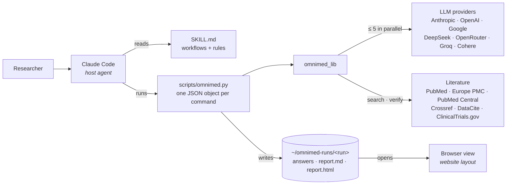
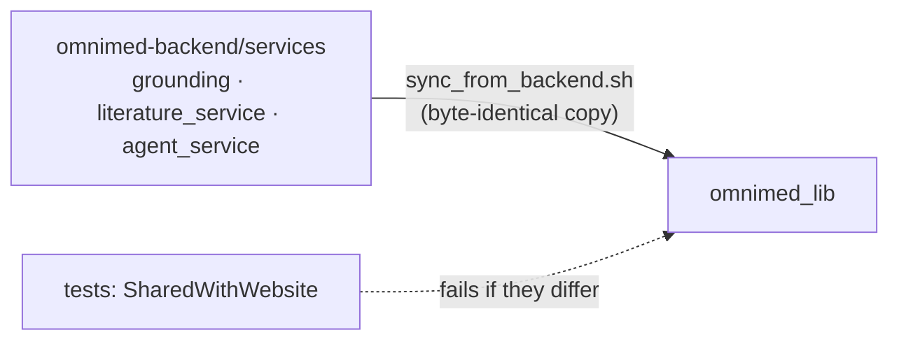
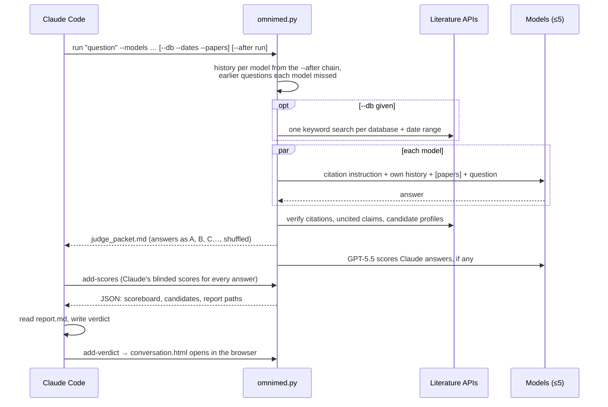

# OmniMed Skill — System Design

The OmniMed Skill brings the [OmniMed website](https://github.com/chitrashensah/omniMed)'s
research workflow into Claude Code: ask up to five AI models the same
cardiovascular ncRNA question, optionally ground them in PubMed or Europe PMC
papers, check every citation, score the answers blind, and show them side by
side. It is built so that **the skill and the website reach the same verdict on
the same answer**: the code that grounds a question, checks citations and scores
answers is shared, byte for byte.

---

## 1. Architecture



**Division of labour.** Claude Code is the interface and the analyst: it picks
the workflow from `SKILL.md`, asks the user which models to compare, reads the
report, and writes the verdict. The script does everything that must be exact
and repeatable: calling the models, checking citations, scoring, and writing
the report. Every command prints one JSON object so the host can parse it; long
material goes to files in the run directory.

---

## 2. Components

| Path | Responsibility |
|---|---|
| `skills/omnimed/SKILL.md` | What Claude reads: when to use the skill, the workflows, the rules |
| `skills/omnimed/reference/interpreting-results.md` | What each metric means |
| `scripts/omnimed.py` | The CLI: setup, models, defaults, search, verify, unsourced, ask, run, compare, add-answer, remove-answer, add-verdict, open |
| `omnimed_lib/models.py` | The 23-model registry (mirrors the website), provider calls over plain HTTP, judge selection |
| `omnimed_lib/env.py` | API keys from env files outside the repo; reports presence as booleans only |
| `omnimed_lib/report.py`, `report_html.py` | The markdown report and the browser view (the website's layout) |
| **`omnimed_lib/grounding.py`** | *Shared with the website:* base prompt, literature grounding, history caps, the missed-questions note |
| **`omnimed_lib/literature_service.py`** | *Shared:* literature search, citation verification (incl. full text), uncited claims, candidate profiles |
| **`omnimed_lib/agent_service.py`** | *Shared:* the judge rubric and reply parsing |

### Shared code, not copied code



The three shared modules live in the website's backend and are copied, unchanged,
by `scripts/sync_from_backend.sh`.
`tests/test_omnimed.py` fails if any copy differs from the website's, so a fix
made in one place cannot silently diverge. The modules import only the standard
library, `httpx` and each other (`grounding` imports `literature_service`), which
is what lets the same file run in both projects.

---

## 3. Asking and comparing (`run`)



What each model receives, and when, is decided by the shared `grounding.py`,
exactly as on the website:

| Part | When |
|---|---|
| How to cite (nothing about format or content) | Always, unless `--no-prompt` |
| Its own earlier questions and answers | Follow-ups (`--after`): the whole conversation, unshortened (up to ~75k tokens) |
| Earlier questions it never saw | It was not part of an earlier run |
| Papers from PubMed / Europe PMC | `--db` given; `auto` = the 25 best matches, 8 with abstracts |
| Date-range rule (strict) | `--dates` given: `1y`, `5y`, `10y` or a start year (`2018`) |

**Independence.** A model never sees another model's answers, so the comparison
stays fair. **Thinking is always on:** Claude runs adaptive thinking at effort
`high`; the other providers reason by default, with no cap on thinking: output
ceilings are high (32,768; Gemini 65,536; a lower model maximum is read from the
provider's error) and the timeout is 10 minutes.

---

## 4. Measuring answers

The same three layers as the website, kept in separate fields:

1. **Citation check (rules, no AI).** Identifiers resolved in PubMed, Crossref
   and DataCite; author–year citations matched by a fielded PubMed search; support
   judged by whether the paper names the claim's molecule or target, with a
   full-text second look (Europe PMC, then NCBI PubMed Central). Results carry a
   `checker_version`; a saved result from an older checker is re-run, not reused.
2. **AI score.** Claude (the host, on the user's subscription) scores every
   answer from an anonymised, shuffled packet, before it sees which model wrote
   which. A Claude answer is also scored by GPT-5.5, since Claude may favour its
   own style even unnamed; its score is the average, and the report gives both.
   No judge is told which model wrote an answer; overall = the average of
   evidence, mechanism, actionability and calibration. (`--judge auto`, used
   only outside the skill's workflow, has one API judge score every answer, as
   on the website, from a maker none of the compared models come from.)
3. **Wet-lab verdict.** Recorded on the website; the only ground truth.

---

## 5. Data: the run directory

```
~/omnimed-runs/<timestamp>-<question>/        (OMNIMED_RUNS_DIR overrides)
├── question.txt
├── run.json            the run this one follows (after) and literature options
├── answers/<model>.md  each answer exactly as written
├── answers/<model>.json status, served model id, tokens, time, papers given
├── comparison.json     checks, scores, candidates, verdict (machine-readable)
├── report.md           the report Claude reads and shows
├── report.html         this question's view
└── conversation.html   (first run only) every question of the conversation on one page
```

A conversation is a chain of runs linked by `run.json → after`. Swapping a model
re-uses everything that did not change (matched by answer hash and checker
version), so only the new model is asked, checked and scored.

---

## 6. Security and privacy

| Concern | Design |
|---|---|
| API keys | Read from `~/.config/omnimed/*.env` or `OMNIMED_ENV_FILE`, never from the skill folder; never printed (`setup` reports booleans); the host is told never to read them |
| Dependencies | One package (`httpx`), installed into a private venv at `~/.cache/omnimed/venv` on first use |
| Model text in the browser | Rendered as Markdown only through DOMPurify; plain text if the libraries do not load |
| Data | Runs stay on the user's machine; nothing is uploaded except the questions sent to the chosen providers and the identifiers sent to the literature APIs |
| Paid models | Never added unless the user chose them; the judge prefers free models |
| Limits | 5 models per run; 40 citations and 8 full-text look-ups per answer; PubMed paced at 2.5 requests/s (9 with `NCBI_API_KEY`) |

---

## 7. Where it runs

| Client | Status |
|---|---|
| Claude Code (terminal, desktop app's Code tab) | Fully supported: scripts run locally with network access and the user's keys |
| Claude.ai / Claude desktop chat | Skills run in a cloud sandbox without the user's key files and possibly without network access; the literature tools may work, model comparison will not |
| ChatGPT and other clients | Not supported by a skill; the planned MCP server covers them |

---

## 8. Testing and release

- **Unit tests** (`tests/`, offline): env parsing, model registry vs. website,
  judge provider rules, picker, limits, reports, conversation chain, literature
  options, shared-code parity. **Live tests** (`OMNIMED_LIVE=1`): PubMed checks
  on fixture answers.
- **Behaviour evals** (`evals/`, `claude plugin eval`): should-trigger and
  should-not-trigger prompts with graded expectations.
- **Release:** `claude plugin validate --strict .`, bump `version` in
  `.claude-plugin/plugin.json`, add a `CHANGELOG.md` entry, then
  `claude plugin tag .` to create the release tag.

---

## 9. Next steps

- **MCP server** on the website's backend, exposing the same tools to Claude
  desktop, claude.ai and ChatGPT, with the website's database as the shared
  store for wet-lab results.
- **Submitting a wet-lab score** from the skill, once that server exists.
